# The Timeline - Database


A timeline application built as part of the MERN program. The project uses
Express and EJS for the web application and MongoDB with Mongoose for post
storage.

> **Status:** Post creation, editing, deletion, and server-side validation are
> implemented. 

# CREATE POST
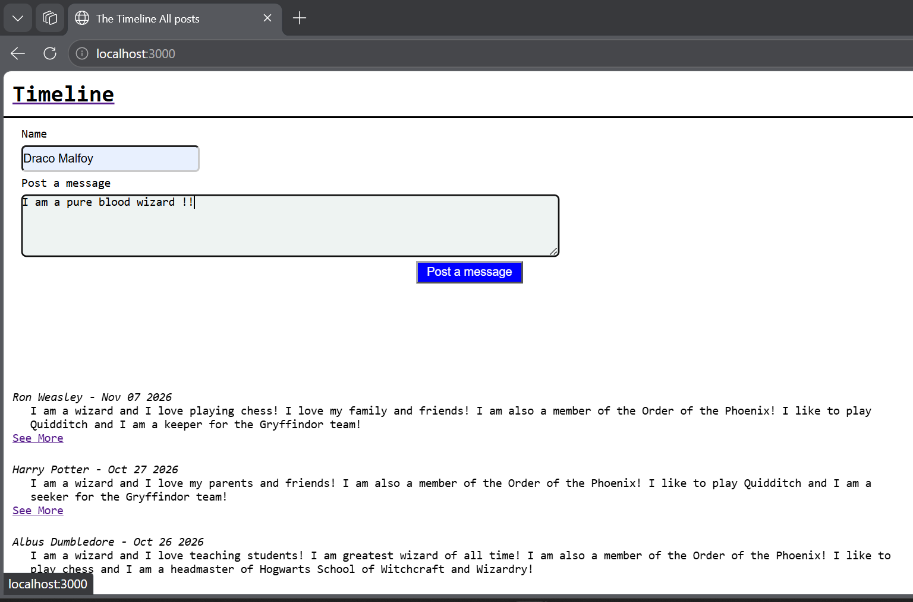
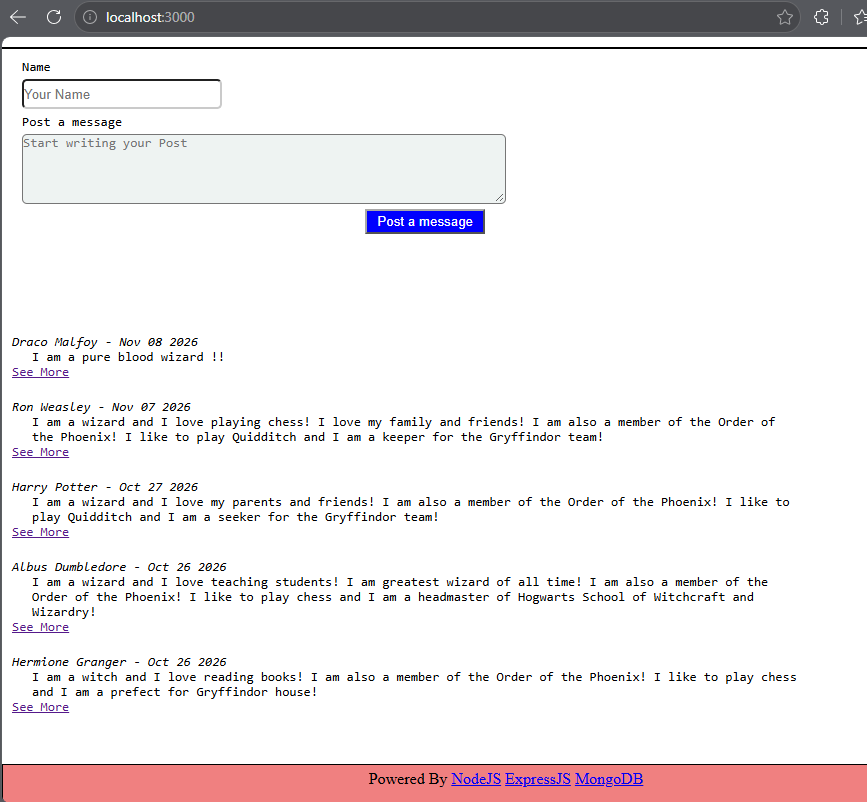

# VIEW A POST 
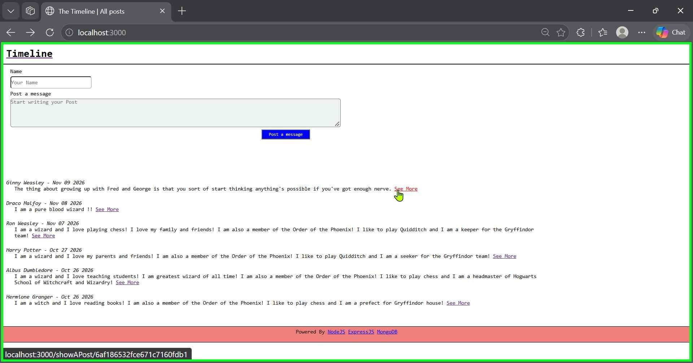 
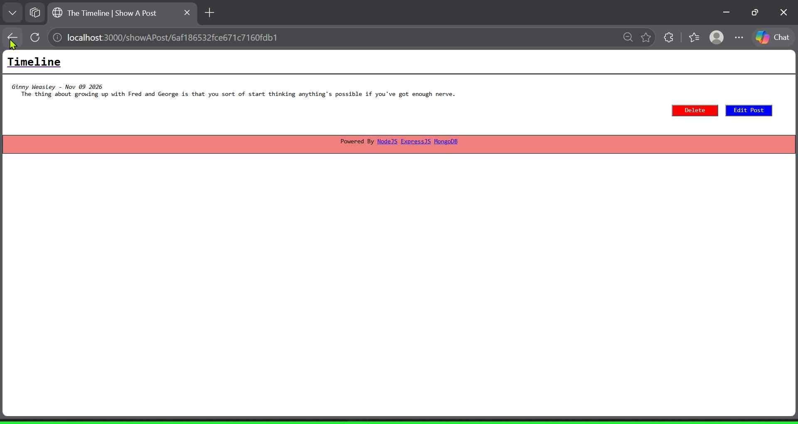 

# DELETE A POST
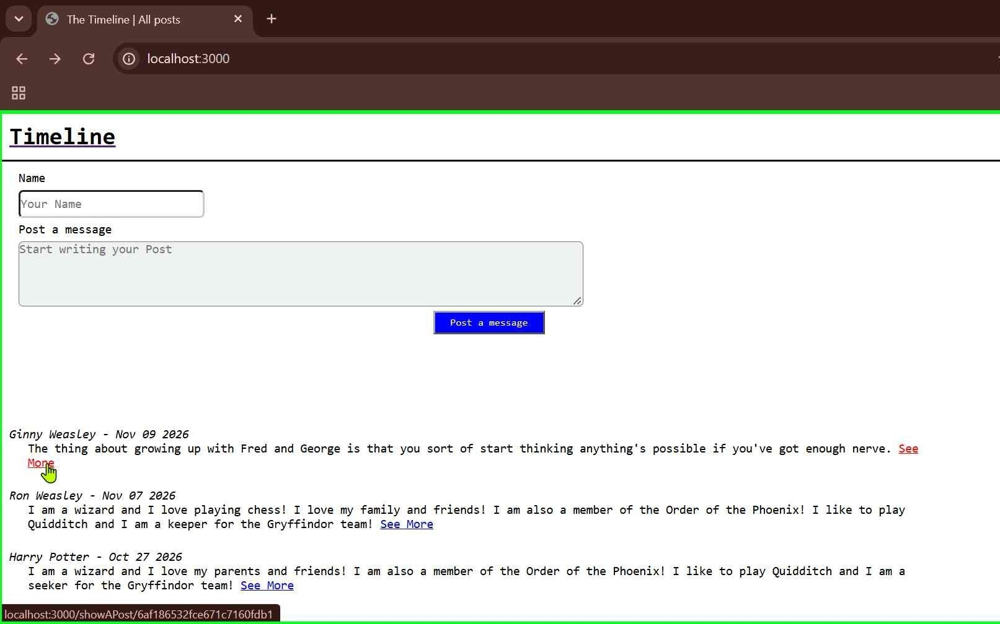 
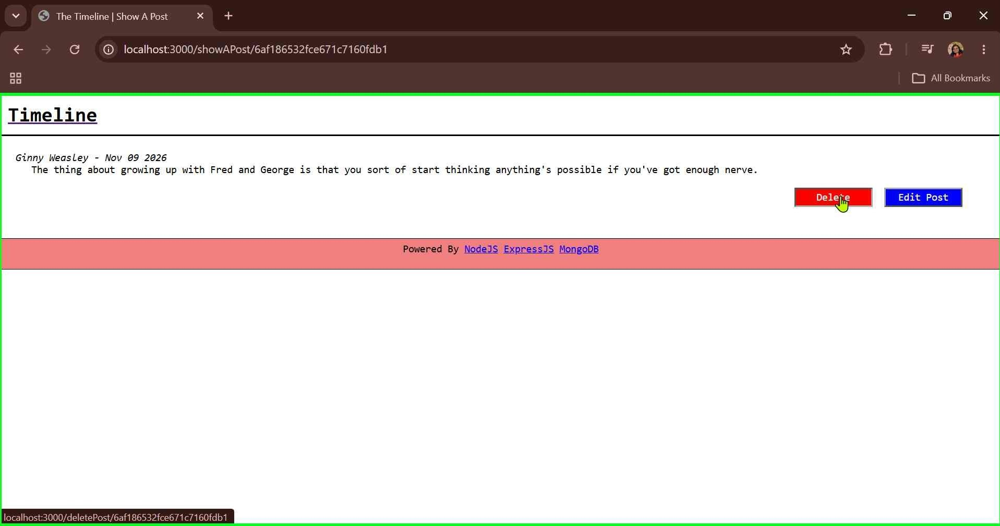 
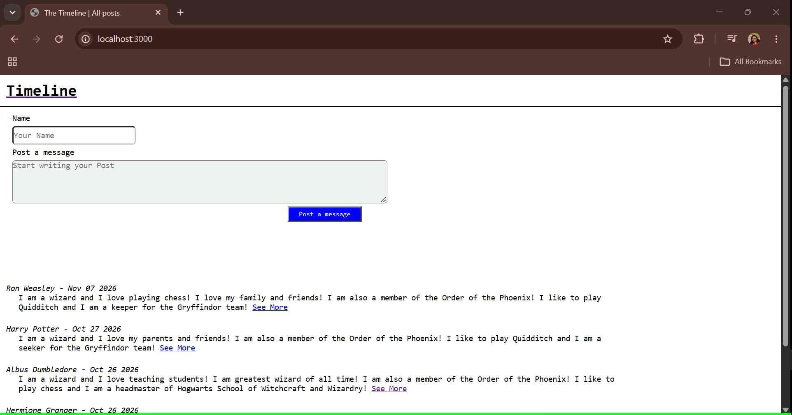 

# EDIT A POST
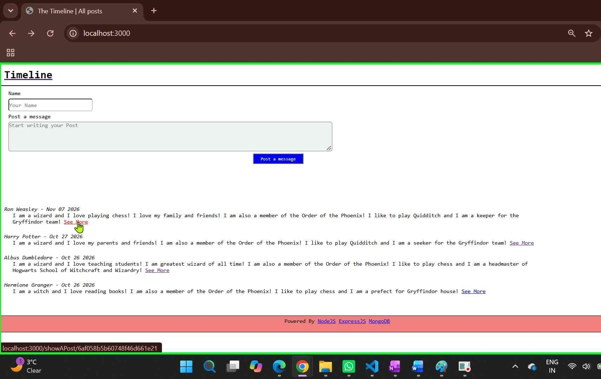 
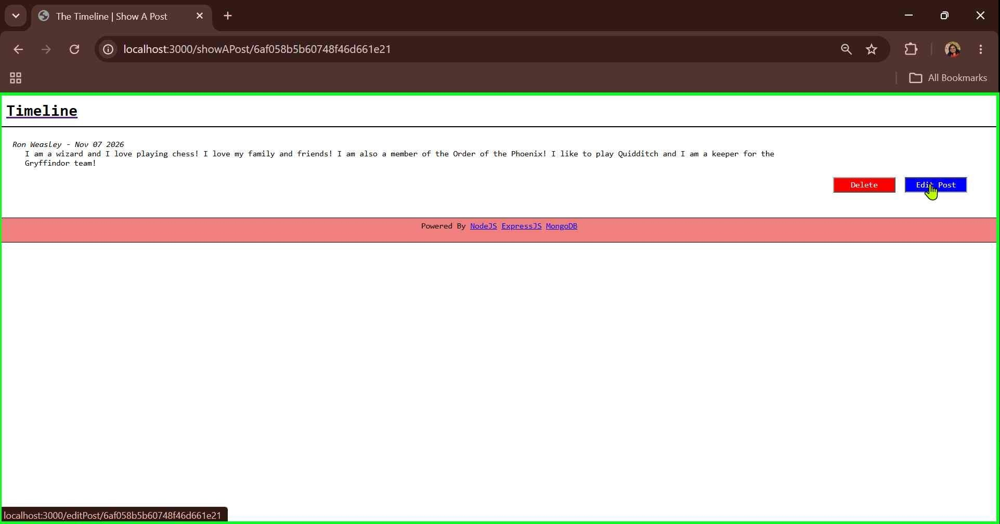 
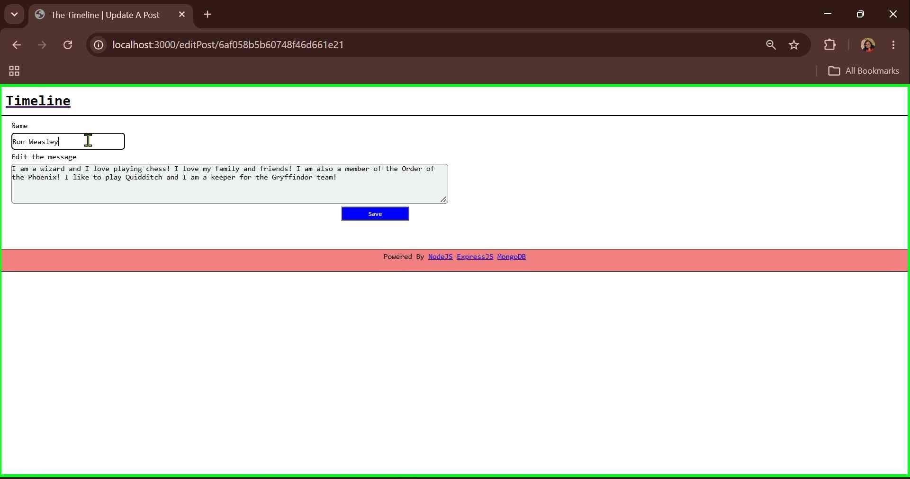 
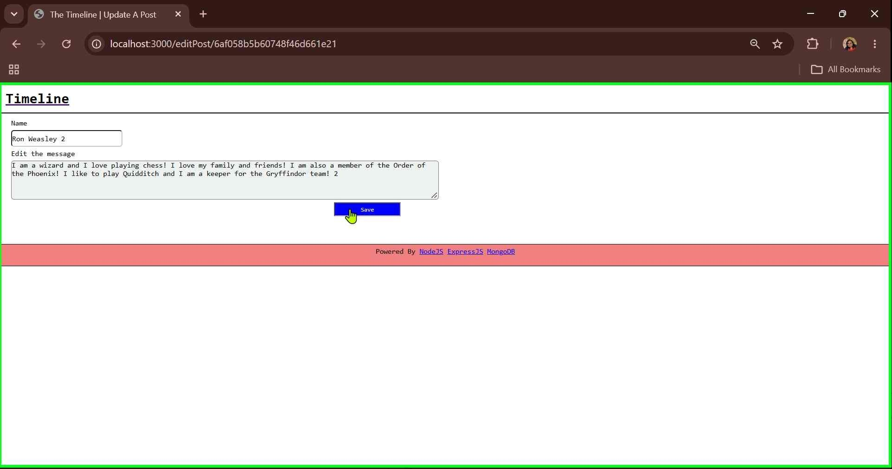 
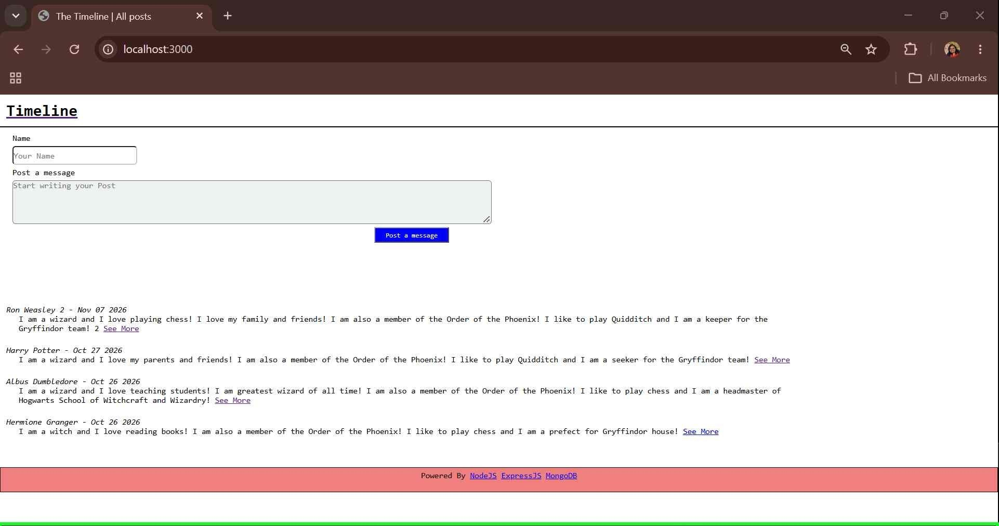 

# VALIDATE A POST 
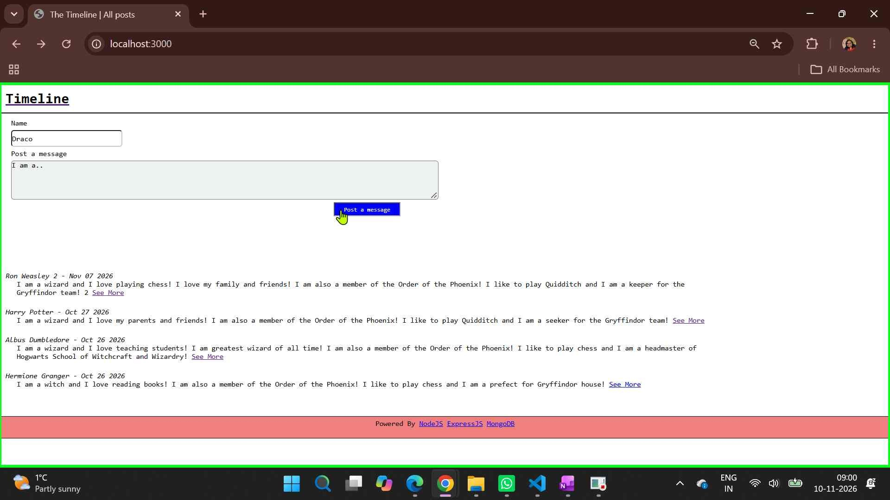 
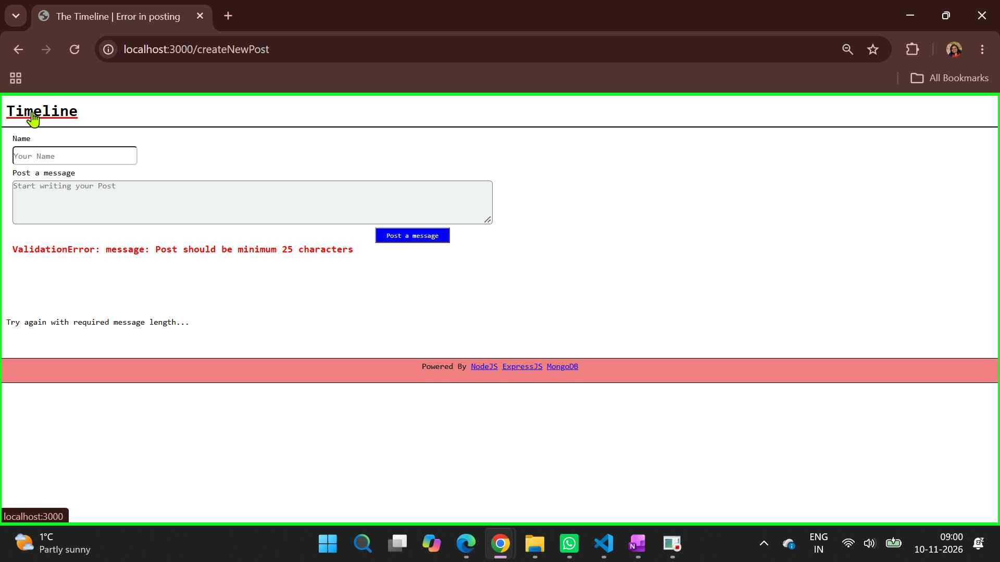 
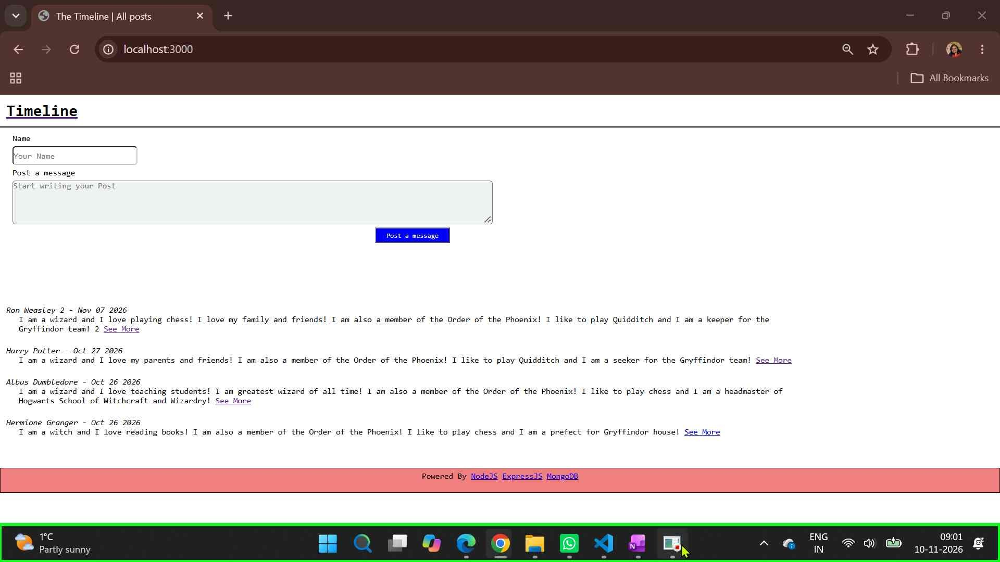 


## Features and routes

The current application includes code for:

- Listing posts on the home page (`GET /`).
- Viewing a post by its ID (`GET /showAPost/:id`).
- Submitting a new post (`POST /createNewPost`).
- Editing a post (`GET /editPost/:id` and `POST /updatePost/:id`).
- Deleting a post (`GET /deletePost/:id`).
- Validating post fields on the server and reporting validation errors.
- Rendering a not-found page (`GET /404`).

Post data has a name and message, with Mongoose timestamps enabled (`createdAt`
and `updatedAt`). The list is ordered newest first.

## Directory structure

```text
Assignment2_The_timeline_Database/
├── app.js                       # Express app setup and server startup
├── package.json                 # Dependencies and npm scripts
├── .env.example                 # Example MongoDB connection setting
├── config/
│   ├── database.js              # Mongoose connection
│   └── routes.js                # Application routes
├── controller/
│   └── userController.js        # Post and page request handlers
├── models/
│   └── postModel.js             # Mongoose post schema
├── public/
│   ├── css/
│   │   └── style.css            # Application styles
│   └── HP.png                   # Static image asset
└── views/
    ├── 404.ejs                  # Not-found page
    ├── index.ejs                # Timeline page
    ├── showAPost.ejs            # Single-post page
    └── partials/
        ├── footer.ejs
        ├── head.ejs
        └── nav.ejs
```


`node_modules/` is generated by npm and is not part of the application source.
The local `.env` file is ignored by Git and should not be committed.

## Requirements

- Node.js and npm
- A MongoDB database (local or hosted, such as MongoDB Atlas)

## How to run

1. Open a terminal in this project directory.
2. Install dependencies:
   npm install

3. Create a `.env` file in this directory using `.env.example` as a reference.
   Set `MONGODB_URI` to your own MongoDB connection string. Replace the sample
   username, password, and cluster host with valid values; do not commit real
   credentials.

   MONGODB_URI=mongodb+srv://<username>:<password>@<cluster-host>/

4. Start the development server:

   npm run dev 
   or 
   nodemon app.js

5. Once the database connection succeeds, visit [http://localhost:3000](http://localhost:3000).

The server uses port `3000`, and `npm run dev` starts the app with Nodemon.
There is currently no production `start` script or configured automated test
suite.

## Learnings

This assignment provides practice with:

- Setting up an Express application and organizing routes and controllers.
- Rendering dynamic pages with EJS templates and reusable partials.
- Serving static files such as CSS and images from Express.
- Parsing form submissions and JSON request bodies.
- Defining a Mongoose schema and connecting an application to MongoDB.
- Creating and reading documents, sorting query results, and using timestamps.
- Updating and deleting MongoDB documents and handling validation errors.
- Using environment variables for database configuration.

## Notes
- A valid MongoDB connection string is required before the application can
  start serving requests.
