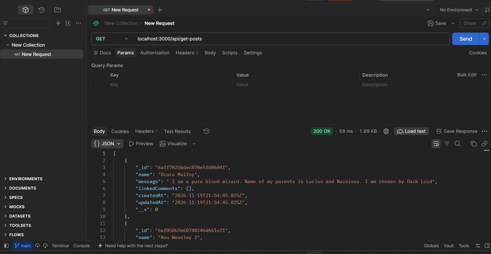
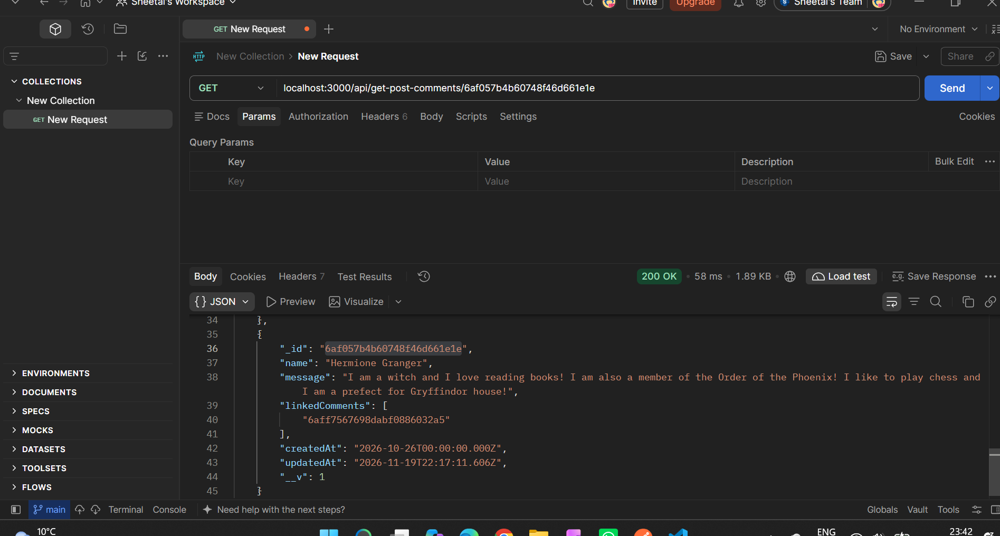
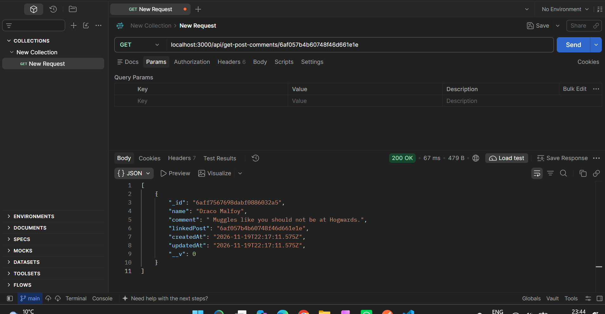

# Timeline API

The API is mounted at `/api` and accepts JSON request bodies. With the app running locally on its configured port, use `http://localhost:3000/api` as the base URL.

## Testing with Postman

The API endpoints were tested using Postman. To try them, start the app and send requests to the base URL above. For `POST` and `PUT` requests, select **Body → raw → JSON** and use the request-body examples below. Replace `:id` with an existing post's MongoDB ObjectId for update, delete, and comment requests.

### GET POSTS


### GET COMMENTS FOR posts

 

## Endpoints

| Method | Endpoint | Functionality |
| --- | --- | --- |
| `GET`    | `api/get-posts` | Returns all posts as JSON, newest first. |
| `POST`   | `api/create-post` | Creates a post and returns it as JSON (`201`). |
| `PUT`    | `/api/edit-post/:id` | Updates the post with the supplied ID. |
| `DELETE` | `/api/delete-post/:id` | Deletes the post and its linked comments. |
| `GET`    | `/api/get-post-comments/:id` | Returns the post's comments as a JSON array. |
| `POST`   | `/api/post-post-comment/:id` | Adds a comment to the post and returns it as JSON (`201`). |

Replace `:id` with the MongoDB ObjectId of the post.

## Request bodies

Send JSON with the `Content-Type: application/json` header.

Create a post:

```json
{
  "name": "Alex",
  "message": "A post message that is at least 25 characters long."
}
```

Post fields: `name` is required; `message` is required and must be at least 25 characters. `linkedUser` may also be provided.

Update a post by sending the fields to change in the request body, for example:

```json
{
  "message": "An updated post message that is at least 25 characters."
}
```

Add a comment:

```json
{
  "name": "Sam",
  "comment": "A comment that is at least 15 characters."
}
```

Comment fields: `name` is required; `comment` is required and must be at least 15 characters. The API sets `linkedPost` from the post ID in the URL. `linkedUser` may also be provided.

## Responses

Successful reads return JSON. Creating a post or comment returns `201` and the created document. Updating a post returns `{ "message": "Post Updated" }`; deleting one returns `{ "message": "Post deleted" }`.

Post validation failures when creating a post return `400`. Missing posts return `404`. Other controller errors—including comment validation failures—return `500` with an `error` message.